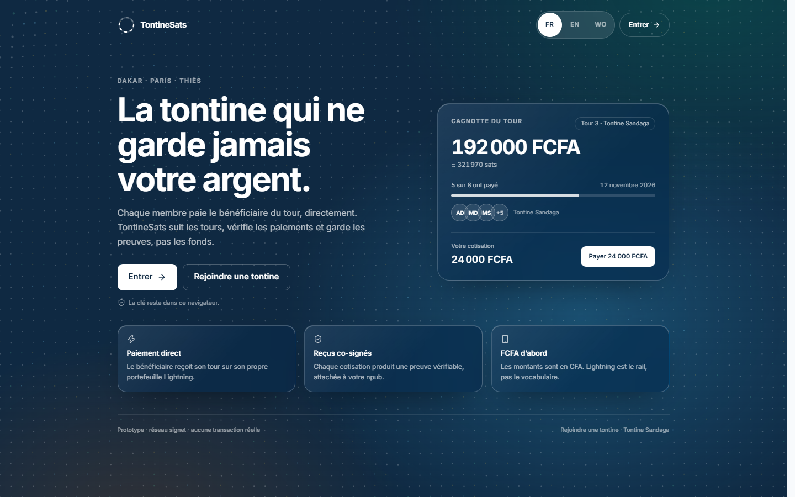
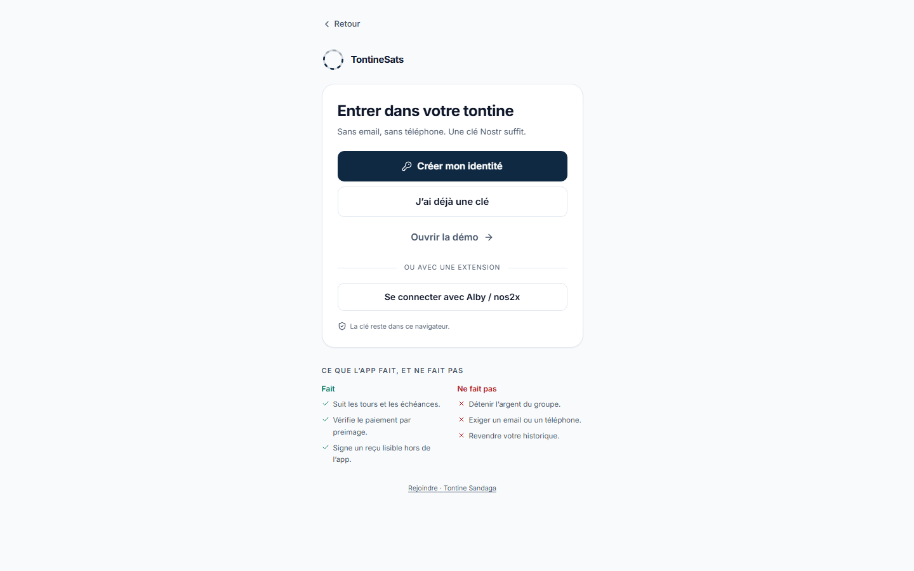
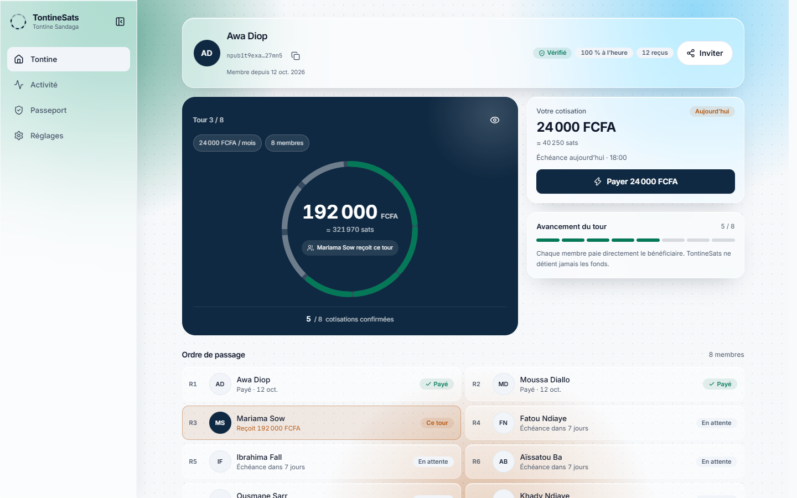
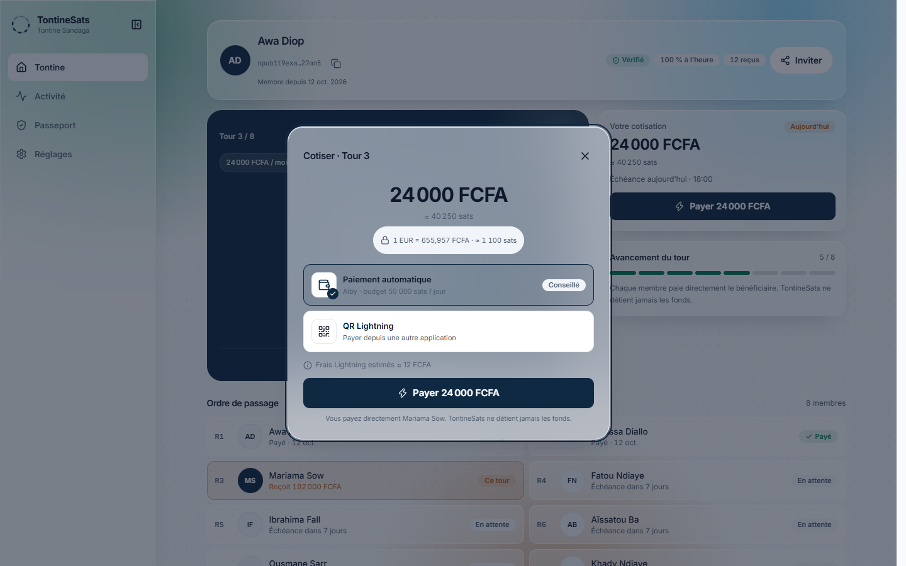
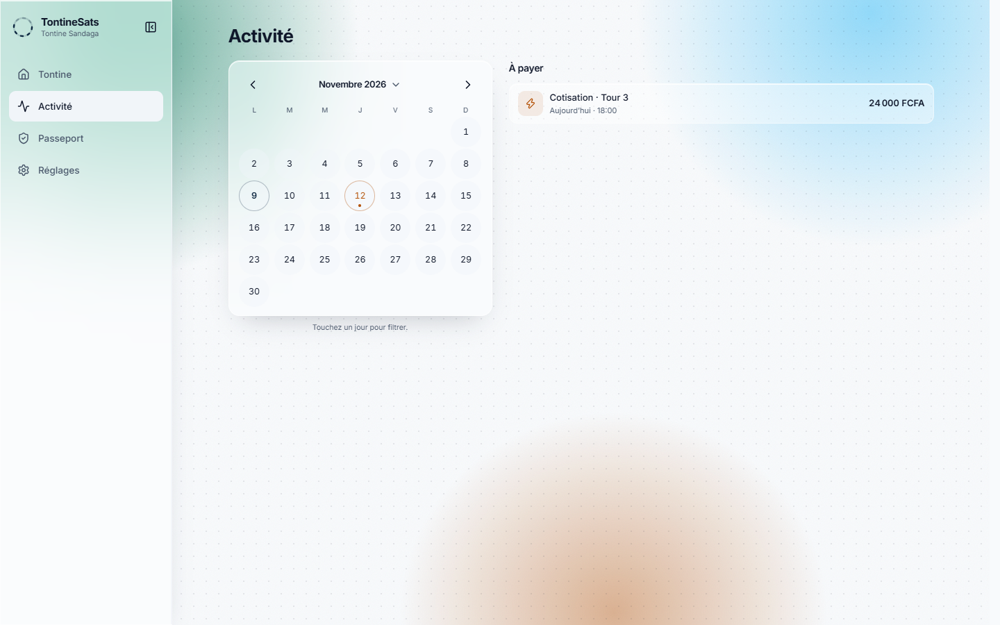
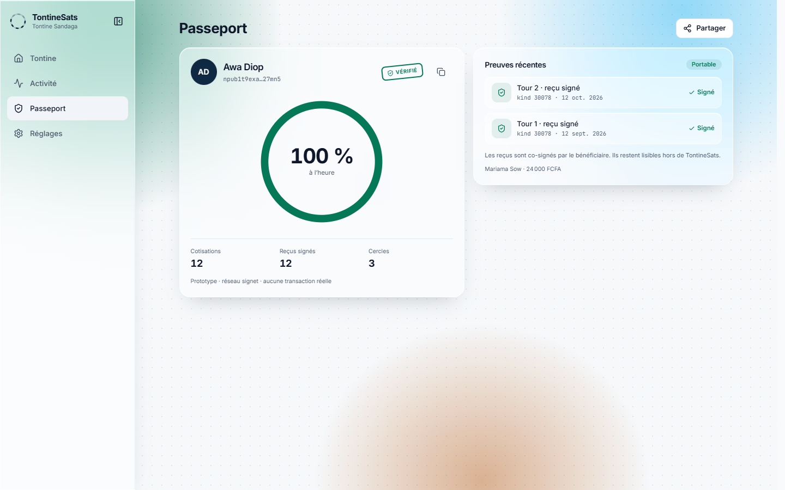
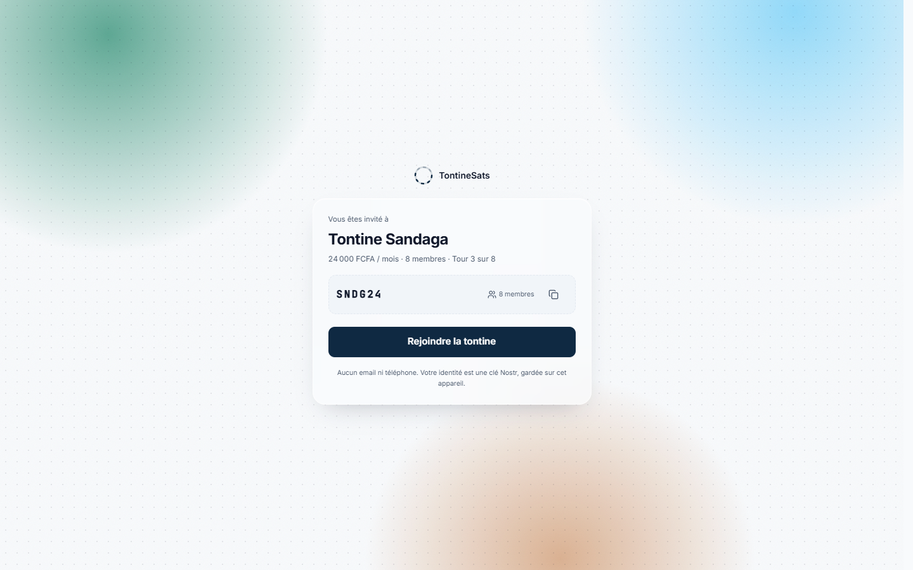
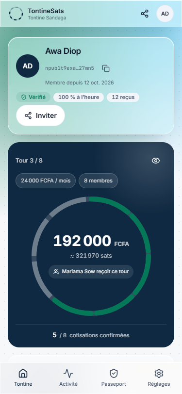
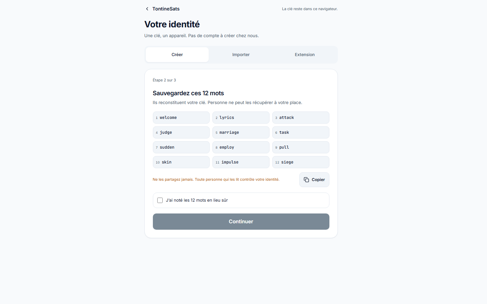
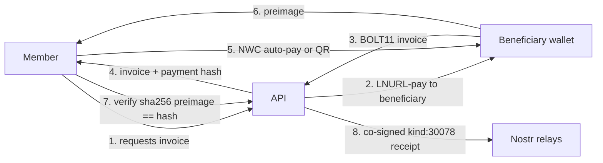

# TontineSats

A cross-border tontine you can join from anywhere, that never holds your money, and where your payment record belongs to you.

Traditional rotating savings circles (*tontines*, *natt* in Wolof) are how most of Senegal saves and borrows. They break when members move abroad, when the treasurer tracks payments in a notebook, and when a member's credit history is locked inside someone else's app. TontineSats keeps the circle, replaces the notebook with signed receipts, and settles every contribution peer-to-peer over Lightning.

- **Non-custodial by construction.** The app never holds a pot. Each round, every member pays that round's beneficiary directly, against an invoice the beneficiary's own wallet issued.
- **CFA first.** Amounts are set and shown in West African CFA Franc (`FCFA`), with EUR for diaspora members and sats as a subtitle.
- **Two ways to pay.** Members with Nostr Wallet Connect are charged in one click. Members without it scan a BOLT11 invoice.
- **Portable reputation.** Every settled contribution becomes a Nostr `kind:30078` receipt co-signed by the beneficiary. The record travels with the member's `npub`, not with this app.

Status: hackathon build. The backend, Lightning settlement, sandbox verification, and signed receipts work end to end. The identity layer still keeps the `nsec` in `localStorage`, which is fine for a demo and not for production.

## Screens

| Landing | Sign in | Dashboard |
| :--- | :--- | :--- |
|  |  |  |

| Payment | Activity | Reputation passport |
| :--- | :--- | :--- |
|  |  |  |

| Invite | Mobile | Recovery words |
| :--- | :--- | :--- |
|  |  |  |

## How the money moves

There is no balance to reconcile. A round is a set of invoices, and the proof that a contribution happened is the Lightning preimage.



- The server stores `amount_xof`, `amount_sats`, `bolt11_invoice`, `payment_hash`, `status`, and finally `payment_preimage` for each payer in each round.
- `sha256(preimage) === payment_hash` is the only accepted proof of payment. No trusted balance, no platform custody.
- When every contribution in a round is paid, the round closes and the next beneficiary's round opens automatically.
- The receipt contains circle, round, payer, beneficiary, amount, payment hash, preimage, and timestamp, signed by the beneficiary. The passport page verifies the signature in the browser.

### Sandbox mode

Without `LNBITS_URL` and without a reachable Lightning Address, invoice creation falls back to a verifiable sandbox: a real SHA-256 preimage/hash pair and a lookalike `lntbs…` string, stored server-side, settled by the "Simuler" button. The cryptography is real; no sats move. This is what judges see by default.

## Stack

- **Client:** React 19, Vite, TypeScript, Tailwind CSS 4, `react-router-dom`, `lucide-react`.
- **Server:** Hono, Drizzle ORM, LibSQL (SQLite file locally, Turso in production), `node-cron` for the local scheduler.
- **Bitcoin / Nostr:** `nostr-tools` (BIP39 + NIP-06 identity, `kind:30078` receipts), `@getalby/sdk` (NIP-47 NWC), LNURL-pay, BOLT11.
- **Hosting:** one Docker container locally, or Vercel + Turso (both free, no credit card).

## Run locally

```bash
npm install
npm run dev        # client on http://localhost:5173, API on :3001
```

`npm run dev` starts Vite and `tsx watch` together. Vite proxies `/api` to the API server.

| Script | Does |
| :--- | :--- |
| `npm run dev` | client + API in watch mode |
| `npm run dev:client` | Vite only |
| `npm run dev:server` | API only |
| `npm start` | production API + built client on `:3001` |
| `npm run build` | Vite production bundle |
| `npm run build:vercel` | bundle + Vercel Build Output API directory |
| `npm run db:seed` | seed the demo circle directly in the database |
| `npm run test:api` | end-to-end API test (all endpoints, receipts, preimage verification) |
| `npm run typecheck` | client and server type checks |
| `npm run check:ui` | scripted UI flow check |

Seed the judge demo without the UI:

```bash
curl -X POST http://localhost:3001/api/v1/demo/seed \
  -H 'content-type: application/json' -d '{"reset":true}'
```

The seed creates Awa (Dakar, organizer, NWC), Moussa (Paris, NWC), and Fatou (Thiès, manual QR) in a circle with a 5-minute round frequency.

## Configuration

Copy `.env.example` to `.env`. Everything is optional locally.

| Variable | Purpose |
| :--- | :--- |
| `DATABASE_URL` | `file:data/tontinesats.db` locally, `libsql://…` on Turso |
| `DATABASE_AUTH_TOKEN` | Turso token, required for `libsql://` |
| `PORT` | API port, default `3001` |
| `NWC_ENCRYPTION_KEY` | AES-256-GCM key for stored NWC URIs; changing it invalidates saved connections |
| `NOSTR_ATTESTATION_NSEC` | key that co-signs receipts; without it a deterministic fallback key is used |
| `CRON_SECRET` | shared secret for `/api/v1/cron/run`; the endpoint is disabled when empty |
| `LNBITS_URL`, `LNBITS_API_KEY` | optional invoice fallback when a beneficiary has no Lightning Address |
| `ENABLE_LIVE_LNURL` | `false` skips LNURL-pay and goes straight to LNbits/sandbox |
| `NOSTR_RELAYS` | comma-separated relay list for receipts |
| `DISABLE_NOSTR_PUBLISH` | `1` keeps receipts local (useful for demos) |
| `DISABLE_EXTERNAL_RATES` | `1` forces bundled BTC/XOF/EUR fallback rates |

Generate the secrets:

```bash
# NWC_ENCRYPTION_KEY and CRON_SECRET
node -e "console.log(require('crypto').randomBytes(32).toString('hex'))"

# NOSTR_ATTESTATION_NSEC
npx tsx -e "import { generateSecretKey } from 'nostr-tools/pure'; import { nsecEncode } from 'nostr-tools/nip19'; console.log(nsecEncode(generateSecretKey()))"
```

## Deploy free, no credit card

Free container hosts either sleep or ask for a card, so production runs as a serverless function: the API becomes one Vercel Function, SQLite becomes a free Turso database, and a free external pinger drives the scheduler that `node-cron` handled locally. Every feature survives; only the host changes.

| Piece | Service | Free tier | Card |
| :--- | :--- | :--- | :--- |
| Web + API | Vercel Hobby | 1 function, 100 GB bandwidth | no |
| Database | Turso | 1 database, 5 GB | no |
| Scheduler | cron-job.org | 1 job, every minute | no |

**1. Turso.** Sign up at <https://turso.tech>, create a database, copy the `libsql://…` URL, and create a token (`turso db tokens create <db>`). Tables are created by the app on first request.

**2. Vercel.** Sign up at <https://vercel.com> with GitHub, then:

```bash
npx vercel login
npx vercel link
npx vercel env add DATABASE_URL production
npx vercel env add DATABASE_AUTH_TOKEN production
npx vercel env add NWC_ENCRYPTION_KEY production
npx vercel env add NOSTR_ATTESTATION_NSEC production
npx vercel env add CRON_SECRET production
npx vercel build --prod
npx vercel deploy --prebuilt --prod
```

`--prebuilt` is the reliable path: Vercel uploads the `.vercel/output` directory produced by `build:vercel` instead of reinterpreting the project. If you import the repo in the dashboard instead, set **Framework Preset** to **Other**.

**3. Scheduler.** Create a free cron job at <https://cron-job.org>:

- URL: `https://<your-app>.vercel.app/api/v1/cron/run`
- Schedule: every 1 minute
- Method: `POST`
- Header: `x-cron-secret: <CRON_SECRET>`

A daily Vercel cron is also declared in `config.json` as a safety net. Vercel Hobby only allows daily schedules, which is too coarse for the 5-minute demo rounds.

**4. Verify.**

```bash
curl https://<your-app>.vercel.app/api/v1/health
curl -X POST https://<your-app>.vercel.app/api/v1/demo/seed \
  -H 'content-type: application/json' -d '{"reset":true}'
```

If `/api/v1/health` returns 404, Vercel ignored the Build Output API — redeploy with `--prebuilt`.

### Docker

```bash
docker build -t tontinesats .
docker run -p 3001:3001 -v tontinesats-data:/data tontinesats
```

The image serves the built client and the API on `:3001` and keeps SQLite in `/data`.

## API

| Method | Endpoint | Description |
| :--- | :--- | :--- |
| `GET` | `/api/v1/health` | liveness |
| `GET` | `/api/v1/rates` | BTC/XOF/EUR rates (5-minute cache, fallback) |
| `POST` | `/api/v1/users/profile` | create or update a Nostr profile and wallet fields |
| `POST` | `/api/v1/circles` | create a circle |
| `GET` | `/api/v1/circles` | list circles, optionally by `?npub=` |
| `GET` | `/api/v1/circles/invite/:code` | resolve an invite code |
| `GET` | `/api/v1/circles/:id` | circle detail, members, rounds, contributions |
| `POST` | `/api/v1/circles/:code/join` | join by invite code |
| `POST` | `/api/v1/circles/:id/start` | lock payout order and open round 1 |
| `POST` | `/api/v1/rounds/:id/invoice` | create the beneficiary's BOLT11 invoice for a payer |
| `POST` | `/api/v1/rounds/:id/trigger-nwc` | pay by NWC, one member or the whole circle |
| `POST` | `/api/v1/contributions/:id/verify` | verify preimage, mark paid, sign and publish receipt |
| `GET` | `/api/v1/users/:npub/reputation` | portable reputation and receipt list |
| `POST` | `/api/v1/rounds/:id/mark-overdue` | demo helper: force a round late |
| `POST` | `/api/v1/demo/seed` | seed the three-persona judge circle |
| `ALL` | `/api/v1/cron/run` | scheduler sweep, requires `CRON_SECRET` |

## Security notes

- **Identity is prototype-grade.** The `nsec` is stored in `localStorage` so a refresh does not sign you out. Move it behind an extension or an encrypted store before real use. NIP-07 login only provides identity; it does not grant payment ability.
- **NWC URIs are encrypted at rest** with AES-256-GCM under `NWC_ENCRYPTION_KEY`. Rotating that key permanently disconnects every saved wallet.
- **Set `NOSTR_ATTESTATION_NSEC` in production.** Otherwise receipts are signed with a deterministic key derived from `NWC_ENCRYPTION_KEY`, and anyone with the source can forge a "paid" receipt.
- **A live LNURL invoice has no callback.** The QR flow therefore asks for the preimage by hand, which is a demo affordance rather than a user flow. Real deployments should verify through LNbits polling or an NWC round-trip.
- **Hobby functions cap at 60 seconds.** Paying every NWC member of a large circle in one request can time out; per-member payment does not.

## License

MIT. See [LICENSE](LICENSE).
