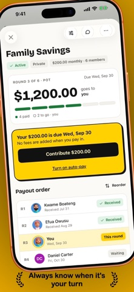
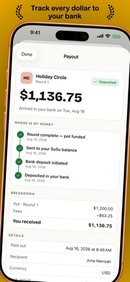
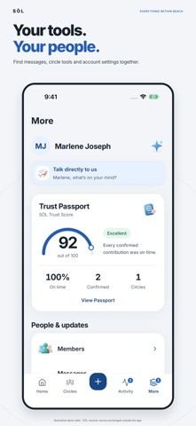

# Design Reference Catalog: TontineSats

> **STATUS:** Research aid. Not a spec. `docs/DESIGN_PRD.md` remains the locked visual constitution.
> **QUESTION:** Which existing app or site can we take something from — a screen, a component, or one small button?
> **METHOD:** App Store screenshot sets inspected on 2026-11-07 (iPhone listings) plus official design-system and product pages fetched the same day. Every row below was actually seen. Nothing is quoted from memory.

**Verification legend**

| Tag | Meaning |
| :--- | :--- |
| **V-S** | Verified from screenshots I opened. |
| **V-D** | Verified from official docs or product page text. |
| **U** | Unverified. Do not cite it in the pitch. |

---

## 0. If we copy only five things

1. **SUSU — payout order list + segmented round bar.** One row per member, current turn highlighted, `4 paid · 2 to go` under a segmented bar. Replaces a rotation ring that most users cannot read at 375px. **V-S**
2. **SUSU — payout receipt timeline.** Four check steps with timestamps, then a money breakdown. This is our preimage-verified receipt, almost line for line. **V-S**
3. **Wise — “You send / They get” with a locked rate chip.** The cleanest diaspora contribution sheet in the category. **V-S**
4. **Blink POS + Phoenix — amount hero with sats subtitle and a unit toggle.** `$4.20` over `~ 10,162 sats`, plus the `sat ⇅` control. **V-S**
5. **SÒL — “Your next moves” and the member due card.** One action on top, everything else below. **V-S**

Everything else in this file is optional polish. These five carry the demo.

---

## 1. Closest product analogs

### 1.1 ROSCA / tontine apps (same job, different rail)

| App | Market | Model seen | Take | Do not take | Link |
| :--- | :--- | :--- | :--- | :--- | :--- |
| **SÒL** | US / Caribbean diaspora | Non-custodial: members pay each other, app keeps records, members upload proof photos, organizer confirms. **V-D** | Non-custodial records framing, proof review flow, Trust Passport layout, activity feed | A private `92/100` trust score — contradicts portable proof | [App Store](https://apps.apple.com/app/id6792436901) |
| **The SUSU App** | US / Caribbean | Rotating circle, fixed visible order, each round one member gets the pot. **V-D** | The entire circle dashboard and receipt screens (sections 2 and 3) | “No fees added” wording; custodian settlement steps | [App Store](https://apps.apple.com/app/id6748971171) |
| **Daret** | Morocco (MAD) | Tontine with create/join by code, organizer confirms, “circle gauge fills up”. **V-D** | Dark-green/cream palette confidence, code-based invite, compact circle rows with amount right-aligned | Cover-photo profile header (weight, and no photo assets) | [App Store](https://apps.apple.com/app/id6751736492) |
| **Money Fellows** | Egypt (EGP) | Custodial, bank-regulated, 8M users. **V-D** | Amount entry with ruler-tick slider + min/max labels, stepped progress bar, tiered “choose a circle” cards | Custodial trust badges, cashback tiers, marketing typography | [App Store](https://apps.apple.com/app/id1113492041) |
| **Zepargn** | Benin (FCFA) | Custodial via AVM, group savings + goals. **V-D** | FCFA number formatting, orange balance header, padded action pills, success modal tone | “Bravo !” confetti loop, red/green amounts as the only status signal | [App Store](https://apps.apple.com/app/id6474701827) |
| **MaTontine** | Senegal (FCFA) | Organizer tool for savings groups, credit scoring. **V-D** | Nothing visual. Use it as the anti-reference. | Giant logo wallpaper, flag-circle language picker, 7-row text menu, duplicated bottom tabs | [App Store](https://apps.apple.com/app/id1636616436) |

**Finding that should change a decision:** all three closest ROSCA apps (SÒL, SUSU, Daret) show the rotation as a **vertical list with one highlighted row**, not a ring. Keep the ring for `md:` and treat the list as the primary mobile control. **V-S**



*The row to copy: `R3 · You · This round`, with the pot above it and the pay button pinned below. SUSU, App Store screenshots.*

### 1.2 West African money apps (the visual vernacular members already trust)

| App | Why it matters | Take | Link |
| :--- | :--- | :--- | :--- |
| **Wave** (SN, CI, ML, BF) | The reference for FCFA amounts and fee transparency. **V-S** | Purple header with centred balance + eye toggle; QR card floating over the header; 4 circular quick actions; ledger rows with `-2.000F` and a grey timestamp; numeric keypad with letter rows | [App Store](https://apps.apple.com/app/id1523884528) |
| **Djamo** (CI) | French-language fintech with a calm, card-led layout. **V-S** | `Mon solde / 250.600 FCFA` hierarchy, small blue pills `Transférer` / `Payer`, signed coloured amounts in history | [App Store](https://apps.apple.com/app/id1504072402) |
| **Zepargn** (BJ) | Group savings in FCFA, closest local tone. **V-S** | Goal card with `100 000 / 250 000` progress, `Modifier` / `Supprimer` / `Bloquer` outline pills | [App Store](https://apps.apple.com/app/id6474701827) |

### 1.3 Diaspora transfer (the Moussa persona)

| App | Take | Link |
| :--- | :--- | :--- |
| **Wise** | Locked rate chip `🔒 1 EUR = 0.83336 GBP`; “You send exactly / They get” pair; breakdown rows with a `Change` pill and a `›` disclosure. **V-S** | [App Store](https://apps.apple.com/app/id612261027) |
| **LemFi** | Stacked account rows (Cash / Credit / Savings / eSIM) and a rate chip pinned next to the send amount. **V-S** | [App Store](https://apps.apple.com/app/id1533066809) |
| **NALA** | `Rates $1 = 88 INR` row with `Compare rates →`; `Send` filled pill beside `+ Add recipient` outline pill; avatar rail for repeat recipients. **V-S** | [App Store](https://apps.apple.com/app/id1549983218) |
| **Lydia** | Shareable payment link rendered as a card inside a chat thread; two-tone `Send` / `Collect` split. **V-S** | [App Store](https://apps.apple.com/app/id6475691727) |

### 1.4 Lightning wallets (the payment moment)

| App | Take | Link |
| :--- | :--- | :--- |
| **Blink** | `$4.20` over `~ 10,162 sats`, `Add note ✎` with an orange pencil, keypad below. Dual-balance account rows: `42,394 SAT` / `~ $11.29`. **V-S** | [App Store](https://apps.apple.com/app/id1531383905) |
| **Phoenix** | `28,000 sat ⇅` unit toggle, `≈ 9.72 USD`, green `⚡ Pay` pill, then `amount` / `lightning fee 116 sat 0.41%` disclosure. **V-S** | [App Store](https://apps.apple.com/app/id1544097028) |
| **Alby Go** | Two enormous square action buttons, `↓ Receive` / `↑ Send`, on a near-empty screen. **V-S** | [App Store](https://apps.apple.com/app/id6471335774) |

### 1.5 Group ledger (the organizer's real problem)

| App | Take | Link |
| :--- | :--- | :--- |
| **Splitwise** | `Overall, you owe $287.49` summary; per-group `YOU OWE $80.89` (orange) / `you are owed` (green) / `settled up` (grey); `Settle up` filled beside `Balances` / `Totals` outline buttons. **V-S** | [App Store](https://apps.apple.com/app/id458023433) |
| **Tricount** | Rounded white ledger rows: title, `Paid by Julia` subtitle, amount right-aligned, plus a `Split 3 ways` chip. **V-S** | [App Store](https://apps.apple.com/app/id349866256) |

### 1.6 Checked and rejected

| Source | Why rejected |
| :--- | :--- |
| **Blink Circles** | Name looks right, product is not. It tracks referrals (`Inner Circle` / `Outer Circle`), not money. Do not cite it as a group-savings reference. **V-D** |
| **Cowrywise Circles** | Not ROSCAs: it is a savings-competition leaderboard. Only the preset amount chips are useful. **V-D** |
| **MaTontine** | Visual language is a decade behind and its flag picker cannot represent Wolof. **V-S** |

---

## 2. Screen-by-screen borrow plan

### 2.1 Circle Dashboard (`/circles/:id`)

Order of blocks, top to bottom, all of it seen in one app or another:

| Block | Borrowed from | Detail to copy | Our spec |
| :--- | :--- | :--- | :--- |
| Header chips | SUSU | `✓ Active · Privée · 24 000 FCFA / mois · 8 membres` on one 12px line with `·` separators | `text-xs text-muted-foreground`, max 3 chips, wrap to two lines at 375px |
| Single next action | SÒL “Your next moves” | One card, one primary button, secondary as a text link | `bg-card border border-border rounded-lg p-4`; CTA `min-h-[44px]` |
| Member due card | SÒL | `Aucune cotisation enregistrée / Échéance 22 oct. / [Enregistrer]` | `bg-warning/10 border-warning/30`; amount uses `tabular-nums` |
| Pot hero | Wave, Djamo, SUSU | Centred figure, currency after the number, eye toggle at the right | `text-2xl md:text-4xl font-bold tracking-tight tabular-nums` + `≈ 325 000 sats` in `text-xs text-muted-foreground` |
| Round progress | SUSU | One segment per member, filled = confirmed | `role="progressbar"` + visible `5 sur 8 confirmés`; never colour alone **V-D** |
| Rotation list | SUSU payout order | `R1`…`RN` badge, avatar, name, right pill `Reçu` / `Ce tour` / `En attente` | Current row `border-2 border-primary`; 44px row height minimum |
| Ledger | Wave, Zepargn, Tricount | Title + `Payé par` subtitle left, signed amount right | `font-variant-numeric: tabular-nums`; `text-success` in, `text-destructive` out |
| Sticky CTA | SUSU | Full-width button pinned above the safe area, amount inside the label | `sticky bottom-0`, `pb-[env(safe-area-inset-bottom)]`, `min-h-[44px]` |

**Rotation ring:** keep it as a `md:` enhancement only. Evidence above shows the list is what users actually get.

### 2.2 Payment sheet (NWC auto-pay / BOLT11 QR)

Borrow the full stack:

1. **Amount hero** — `24 000 FCFA` with `≈ 41 000 sats` underneath. Blink POS, Phoenix. **V-S**
2. **Locked-rate row** — `1 EUR = 655,957 FCFA` (fixed peg) and `1 EUR ≈ 1 100 sats`, tappable to a rate sheet. Wise. **V-S**
3. **Method split** — NWC is the default when connected (`Turn on auto-pay` as a plain underlined text link, SUSU). QR is the fallback card, not a second page. **V-S**
4. **Reassurance pill** — one line, honest: `Frais Lightning ≈ 12 FCFA`. Do **not** copy SUSU's “No fees added”. **V-S**
5. **Sticky pay button** — label carries the amount: `Payer 24 000 FCFA`. **V-S**
6. **QR block** — 240px minimum, `font-mono` BOLT11 under it, copy button with a check state, brightness hint. Wave's floating QR card for placement, Blink POS for spacing. **V-S**

*Sats equivalents above are illustrative at `1 BTC ≈ 90 000 €` and must come from the live rate service, never be hardcoded.*

### 2.3 Waiting state (SSE, 5–20 s)

| Element | Source | Detail |
| :--- | :--- | :--- |
| Centred amount + spinner | Phoenix “Confirm Payment” | Amount stays visible, never replaced by a spinner-only screen |
| Status line | SUSU “Settling” banner | `Règlement Lightning en cours…`, elapsed seconds, one calm sentence |
| Escape hatch | GOV.UK button guidance | After 20 s show the manual QR fallback; keep the primary button busy with `aria-busy`, not silently disabled **V-D** |

### 2.4 Receipt / proof screen

Copy SUSU's payout receipt almost literally, substituting our proof chain:

| SUSU step | TontineSats step |
| :--- | :--- |
| Round complete — pot funded | Tournée ouverte — facture BOLT11 émise |
| Sent to your SuSu balance | Paiement reçu — `payment_hash` détecté |
| Bank deposit initiated | Preimage vérifié — preuve cryptographique |
| Deposited in your bank | Reçu Nostr co-signé — `kind: 30078` publié |

Keep SUSU's shape: `Done` at top left, status card with check + big amount, vertical timeline with timestamps, `BREAKDOWN` block, `DETAILS` block. **V-S**



### 2.5 Reputation Passport

SÒL's Trust Passport is the layout: ring gauge, `Excellent`, three stat columns, `View Passport`. **V-S**



**Change the content.** SÒL shows a proprietary `92/100`, which is the opposite of our positioning. Replace it with counts that anyone can re-verify:

```
12 cotisations    100 % à l'heure    12 reçus signés
```

Then a list of receipts, one row per round: circle, round, date, `preimage` link, beneficiary `npub`. GitHub-contribution-list density, not a score.

### 2.6 Join / invite (`/join/:inviteCode`)

| Element | Source | Detail |
| :--- | :--- | :--- |
| Big tappable code | SUSU, Daret, SÒL all use private codes | 6 characters, `font-mono`, 32px, letter-spaced |
| Copy button | Lydia share card | 44×44, `Copy` → `Check` for 2 s, `aria-label="Copier le code"` |
| Share row | Lydia | `Partager sur WhatsApp` first, then native share |
| Join summary | Wise “You get” row | Circle name, organizer, amount, frequency, start date, then one CTA |

### 2.7 Judge persona switcher

No reference app has this, so keep it visually quiet. **U** for any visual claim.

- Trigger: a slim bar above the tab bar, `Mode démo` + three 28px avatars.
- Sheet: NALA's avatar rail pattern, one row per persona with name, city, role, method badge (`NWC` / `QR`), and a `Changer` button.
- Never let it look like a debug tool in the submitted screenshots: hide it behind a long-press in the demo build, or keep it inside a `Démo` tab.

---

## 3. Micro-detail library (the “even just a tiny button” list)

| # | Detail | Seen in | Copy as |
| :--- | :--- | :--- | :--- |
| 1 | Amount with sats subtitle | Blink POS | Hero `24 000 FCFA`, `≈ 41 000 sats` at 12px muted, both `tabular-nums` |
| 2 | Currency unit toggle | Phoenix `sat ⇅` | 44×44 icon button, `ArrowUpDown`, `aria-label="Changer la devise"`, opens FCFA / EUR / Sats sheet |
| 3 | Preset amount chips | Cowrywise | `5 000 · 10 000 · 25 000 · 50 000` pills, `min-h-[44px]`, plus `Autre` |
| 4 | Ruler-tick amount slider | Money Fellows | Only on the create-circle step at `md:`; min/max labels at both ends |
| 5 | Sticky CTA above safe area | SUSU | Full width, amount in the label, `min-h-[44px]` |
| 6 | Fee reassurance pill | SUSU (inverted) | Honest Lightning fee estimate with an `Info` icon; never “0 frais” |
| 7 | Pay-ahead stepper | SUSU `− 1 +` | Two 44×44 buttons, caption `jusqu'à 4 restantes` |
| 8 | Segmented round progress | SUSU | One segment per member; `aria-valuenow`, visible `5 sur 8` |
| 9 | Rotation row | SUSU payout order | `R3` badge, avatar, name, right pill `Ce tour`; current row gets `border-2 border-primary` |
| 10 | Proof timeline | SUSU “Where is my money” | Four steps, green check, timestamp under each, one vertical rule |
| 11 | Money breakdown | SUSU, Wise | `Pot / Frais réseau / Reçu`, right-aligned, tabular |
| 12 | Locked rate chip | Wise | `🔒 1 EUR = 655,957 FCFA`, tappable, disclosure `›` |
| 13 | “You send / They get” pair | Wise, LemFi | Two rows, currency chip left, figure right, rate chip between |
| 14 | Balance eye toggle | Wave | 44×44, `Eye` / `EyeOff`, `aria-pressed`, hides all amounts on screen |
| 15 | Ledger row | Wave, Djamo, Zepargn | Label + grey timestamp left, signed amount right, thin `border-border` divider |
| 16 | White pill ledger row | Tricount | Use on `bg-card`, skip the photo backdrop (data cost on 3G) |
| 17 | Who-owes summary | Splitwise | Sentence first, amount second, three states: `Vous devez` warning / `On vous doit` success / `À jour` muted |
| 18 | Initials avatar | SUSU, SÒL | 40px `rounded-lg`, two initials, background from a fixed set of token pairs |
| 19 | Header status chips | SUSU | `✓ Active · Privée · 24 000 FCFA / mois · 8 membres`, 12px |
| 20 | Three-stat strip | SÒL | `100 % à l'heure · 12 reçus signés · 3 cercles` under the passport |
| 21 | One-action card | SÒL | Exactly one primary action per screen; everything else becomes a text link |
| 22 | Member due card | SÒL | `Aucune cotisation enregistrée` + due date + one CTA, `bg-warning/10` |
| 23 | 7-day activity strip | SÒL | Week row with a dot on the due day, 44px cells; no full calendar |
| 24 | Notification filter pills | SÒL | `Tout / À traiter (1) / Non lues (3)`, counts inside the label |
| 25 | Language switcher | MaTontine (avoid) | Text pills `FR · WO · EN` with `aria-pressed`; **no flags** — Wolof is not a country |
| 26 | Success confirmation | Zepargn | One line of confirmation, one next CTA, no looping confetti |
| 27 | Invite code + copy | Lydia, SUSU | `font-mono` code, 44px copy button, `Copy` → `Check` state |
| 28 | Invoice block | Wave QR card, Blink POS | 240px QR, 12px `font-mono` BOLT11 clamped to 2 lines, copy + brightness hint |
| 29 | Persona sheet | NALA avatar rail | Avatar, name, city, method badge, one `Changer` button per row |
| 30 | Busy button | GOV.UK (V-D) | Keep the button busy with a spinner and `aria-busy`, not greyed out; block double submit |

---

## 4. Deliberately not copying

| Pattern | Where it appears | Why not |
| :--- | :--- | :--- |
| Custodial trust badges (“regulated by the central bank”, “bank-grade”) | Money Fellows, SUSU | We are non-custodial. Our trust object is a signed receipt + preimage, not a regulator logo |
| Opaque trust score `92/100` | SÒL | Contradicts portable, checkable proof; a number we invent is exactly what we criticise |
| Flag picker for languages | MaTontine | Wolof has no flag; the metaphor breaks the moment someone picks `WO` |
| Full-bleed photography behind cards | Tricount, Lydia | Data cost and contrast risk on 3G / low-end Android |
| Looping confetti and gradient motion | Zepargn | Violates the low-motion tier in `DESIGN_PRD` §5 |
| “No fees added” claims | SUSU | Lightning routing has a fee. Say `≈ 12 FCFA` and stay credible |
| Disabled-looking primary buttons | Common in fintech | GOV.UK explicitly advises against them; use a busy state with feedback **V-D** |
| Cashback / tier upsell cards | Money Fellows | Not our product; adds a screen for nothing |
| Giant logo wallpaper | MaTontine | Burns first-paint budget and screams 2015 |

---

## 5. Conflicts with the locked DESIGN_PRD to resolve

| Topic | `DESIGN_PRD` says | Reference evidence | Recommendation |
| :--- | :--- | :--- | :--- |
| Thousands separator | `10 000 FCFA` (space) | Wave `50.500F`, Zepargn `250.000 FCFA`, Djamo `250.600 FCFA` (period) | Keep the space via `Intl.NumberFormat('fr-SN')`, then test on Android WebView. Do not switch to periods without a native check |
| Rotation visual | “rotation ring/list” | All three ROSCA apps use a list | List is the control; ring becomes a `md:` decoration |
| Reputation | “on-time rate + receipts” | SÒL adds a composite score | Ship counts and receipts only |
| Status pill semantics | `Payé` / `En attente` / `En retard` | GOV.UK: tags are non-interactive and use adjectives **V-D** | Keep adjectives; make the pill `aria-hidden` decoration next to real text, or a `<span>` never a button |
| Language switch | FR / WO / EN | MaTontine uses flags | Text pills, no flags |
| Crypto jargon | None on main screen | SUSU and SÒL say `Round 3 of 6`, `Contribute` | Say `cotisation`, `tournée`, `reçu`. Keep `sats`, `BOLT11`, `npub` behind disclosure |

---

## 6. Sources (all opened 2026-11-07)

**Local copies (internal study only, not for shipping):** [`assets/design-refs/`](assets/design-refs/README.md) — 14 screenshots, about 675 KB. App Store screenshots belong to their publishers.

**Screenshots (App Store, iPhone):** SÒL `id6792436901` · SUSU `id6748971171` · Daret `id6751736492` · Money Fellows `id1113492041` · Zepargn `id6474701827` · MaTontine `id1636616436` · Wave `id1523884528` · Djamo `id1504072402` · Lydia `id6475691727` · LemFi `id1533066809` · NALA `id1549983218` · Wise `id612261027` · Tricount `id349866256` · Splitwise `id458023433` · Blink `id1531383905` · Phoenix `id1544097028` · Alby Go `id6471335774` · Cowrywise `id1436590033` · PiggyVest `id1263117994` · Damus `id1628663131` · Primal `id1673134518`

URL pattern: `https://apps.apple.com/app/id<id>`

**Pages (V-D):**
- GOV.UK Design System, Button — https://design-system.service.gov.uk/components/button/
- GOV.UK Design System, Tag — https://design-system.service.gov.uk/components/tag/
- Blink Circles (referral dashboard, rejected) — https://www.blink.sv/en/circles
- Cowrywise Circles (competition leaderboard, rejected) — https://www.cowrywise.com/circles/
- Djamo, French fintech vocabulary — https://www.djamo.com/
- Wise Design (direction only, no tokens) — https://wise.design/
- Money Fellows product framing — https://www.moneyfellows.com/

---

## 7. Still unverified

- Real performance of these apps on 2G/3G and entry-level Android. No measurement was taken. **U**
- Whether SÒL's proof flow accepts photos only or also transaction references. Only the listing text was read. **U**
- Stripe dashboard pill specs, and Monzo pot rings — already cited in `REFERENCES.md` but **not re-checked** in this pass. Treat as **U** until someone opens them.
- Nostr `npub` display and copy patterns in Damus / Primal. Screenshots were too generic to cite a specific control. **U**
