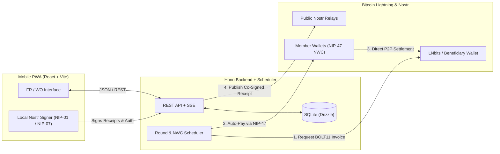
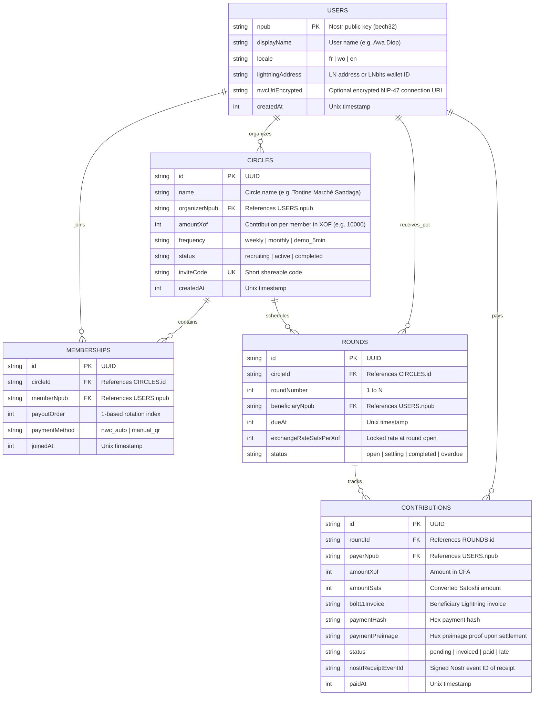

# Product Requirement Document: TontineSats

> **STATUS:** LOCKED & APPROVED  
> **HACKATHON:** Dakar Bitcoin Hack (Devpost — Deadline: November 20, 2026)  
> **ONE-LINE PITCH:** A cross-border tontine you can join from anywhere, that never holds your money, and where your payment record belongs to you.

---

## 1. Executive Summary & Goals

- **Problem Statement:**
  Traditional rotating savings and credit associations (*tontines* / *natt* in Wolof) are the primary credit and savings mechanism for over 60% of economically active adults in Senegal. However, they break down in two critical scenarios:
  1. **Cross-Border Diaspora Friction:** When family or circle members live in France, Italy, or Spain, sending monthly contributions to Dakar incurs 3–8% remittance fees/FX spreads and requires a domestic Mobile Money step.
  2. **Organizer Admin Burden & Locked Credit Data:** Treasurers manually track payments in paper notebooks or WhatsApp chats, chasing late members and resolving disputes. Meanwhile, commercial apps like *MaTontine* or *Zepargn* hold custody via partner banks, exclude unverified diaspora members, and lock payment reputation inside proprietary databases.

- **Core Value Proposition:**
  - **100% Non-Custodial Peer-to-Peer Routing:** The app never holds a communal pool. In each round, every member pays that round's beneficiary *directly* over the Bitcoin Lightning Network.
  - **CFA-First Display, Lightning Underneath:** Members see fixed amounts in West African CFA Franc (`XOF`, e.g., `10 000 FCFA`) or Euros (`EUR`). Lightning converts and settles in seconds, eliminating multi-week Bitcoin volatility exposure.
  - **Automated Direct-Debit via NWC (NIP-47) + QR Fallback:** Members with Nostr Wallet Connect (NWC) have their contributions paid automatically on the due date; members without NWC scan or tap a standard BOLT11 Lightning QR/link.
  - **User-Owned Portable Reputation (Nostr Co-Signed Receipts):** Every settled contribution generates a cryptographically signed receipt event (`kind: 30078` custom app data / attestation) co-signed by the round's beneficiary, giving members a portable, tamper-proof credit history attached to their `npub`.

- **Target Audience & Personas:**
  1. **Primary (The Organizer / Treasurer — "Awa in Dakar"):** A market merchant or community organizer in Dakar managing a circle of 5–12 members. Adopts TontineSats to eliminate manual ledger headaches, automate reminders, and accept instant contributions from members locally and abroad.
  2. **Primary (The Diaspora Member — "Moussa in Paris"):** A Senegalese worker in France contributing €15–€100 (`10 000 – 65 000 FCFA`) per cycle to a family or hometown circle in Dakar without paying MTO remittance fees.
  3. **Secondary (Local Circle Member — "Fatou in Thiès"):** Joins via an invite link on an entry-level Android phone, views schedule in French/Wolof, and pays via QR or hosted LNbits demo wallet.

---

## 2. System Architecture & Tech Stack Decisions

- **Frontend:** **React 19 + Vite (TypeScript) PWA + Tailwind CSS**
  - *Rationale:* Lightweight bundle size for low-end Android devices and intermittent 3G/4G connections in Senegal; installable as a mobile home-screen PWA with service-worker caching.
- **Backend:** **Node.js + Hono (TypeScript)**
  - *Rationale:* Ultra-fast, minimal memory footprint, runs in a single process alongside an in-process cron scheduler (`node-cron`) that triggers round invoice generation and NWC auto-payments.
- **Database:** **SQLite via Drizzle ORM (`better-sqlite3` / LibSQL)**
  - *Rationale:* Zero external database latency, full ACID compliance for round state transitions, trivial single-container deployment, and instant local setup for hackathon judges.
- **Bitcoin, Lightning & Nostr Stack:**
  - **Nostr Identity & Signing:** `nostr-tools` (browser-generated `nsec`/`npub` with 12-word recovery phrase backup, plus NIP-07 browser extension login for Alby/nos2x users).
  - **Nostr Wallet Connect (NIP-47):** `@getalby/sdk` for automated pull payments from member-authorized wallets.
  - **Lightning Node / Demo Sandbox:** **LNbits REST API** (provides instant demo wallets for judges and test personas + BOLT11 invoice creation and webhook/polling settlement checks).
  - **Price Feed:** Live `BTC/XOF` and `BTC/EUR` rate conversion via CoinGecko / Yadio API with 5-minute caching fallback.
- **Deployment & Hosting:** **Railway / Fly.io (Dockerized Single Service)**
  - *Rationale:* Persistent volume for SQLite + always-on process for the NWC scheduler and Lightning invoice watcher.

### High-Level Architecture Flow

---

## 3. Data Model & Entity Relationship (ERD)

---

## 4. API & Interface Contracts

| Method | Endpoint | Description | Request Body | Response Body |
| :--- | :--- | :--- | :--- | :--- |
| `POST` | `/api/v1/users/profile` | Register or update Nostr profile & wallet | `{ npub, displayName, locale, lightningAddress, nwcUri? }` | `{ user }` |
| `POST` | `/api/v1/circles` | Create a new tontine circle | `{ name, organizerNpub, amountXof, frequency }` | `{ circle, inviteUrl }` |
| `GET` | `/api/v1/circles/:id` | Get circle details, rotation order, and active round | *None* | `{ circle, members[], rounds[], currentRound }` |
| `POST` | `/api/v1/circles/:inviteCode/join` | Join circle via invite code | `{ memberNpub, displayName, lightningAddress, nwcUri? }` | `{ membership, circle }` |
| `POST` | `/api/v1/circles/:id/start` | Lock rotation order and open Round 1 | `{ organizerNpub, orderedNpubs[] }` | `{ circle, activeRound }` |
| `POST` | `/api/v1/rounds/:roundId/invoice` | Generate direct P2P BOLT11 invoice from round beneficiary for a member | `{ payerNpub }` | `{ contributionId, amountXof, amountSats, bolt11, paymentHash }` |
| `POST` | `/api/v1/rounds/:roundId/trigger-nwc` | Execute NWC auto-pay for all NWC-connected members in the round | `{ organizerNpub }` | `{ results: [{ payerNpub, status, preimage? }] }` |
| `POST` | `/api/v1/contributions/:id/verify` | Verify payment settlement & publish signed Nostr receipt | `{ paymentPreimage?, signedNostrEvent? }` | `{ contribution, receiptEventId, roundCompleted }` |
| `GET` | `/api/v1/users/:npub/reputation` | Fetch portable reputation & verified Nostr payment receipts | *None* | `{ npub, totalPaidRounds, onTimeRate, receipts[] }` |
| `POST` | `/api/v1/demo/seed` | One-click judge sandbox: seeds a 3-member cross-border circle (Awa in Dakar, Moussa in Paris, Fatou in Thiès) with funded demo LNbits wallets | `{ reset?: boolean }` | `{ circleId, personas[] }` |

---

## 5. Feature Breakdown & Priority (P0 / P1 / P2)

### Milestone 1: MVP Core (P0 — Must Ship for Hackathon Demo)
- [ ] **Feature 1.1: Frictionless Nostr Identity & Invite Onboarding**
  - Auto-generate client-side Nostr keypair (`nsec`/`npub`) with 1-click seed backup or NIP-07 login.
  - Join a circle via shareable link (`/join/:inviteCode`) without email or phone KYC.
- [ ] **Feature 1.2: CFA-Denominated Circle Creation & Rotation Table**
  - Organizer sets contribution in `FCFA` (with live `EUR` and `Sats` preview), sets rotation order, and starts the circle.
- [ ] **Feature 1.3: Non-Custodial P2P Lightning Settlement (NWC + QR)**
  - Beneficiary wallet generates separate BOLT11 invoices for each member.
  - NWC-connected members pay automatically in 1 click; manual members scan/pay QR.
  - Preimage verification marks contribution as `paid` (emerald badge) with zero platform custody.
- [ ] **Feature 1.4: Co-Signed Nostr Reputation Receipts**
  - Each settled contribution creates a verifiable Nostr receipt event containing circle ID, round number, `payment_hash`, payer `npub`, and beneficiary signature.
  - Portable Reputation Profile page displaying on-time completion rate and cryptographic proof links.
- [ ] **Feature 1.5: Judge "1-Click Live Simulation" Mode**
  - Built-in demo switcher allowing hackathon judges to switch between *Awa (Dakar Organizer)*, *Moussa (Paris Diaspora, NWC Auto-Pay)*, and *Fatou (Local Member, QR Pay)* and advance rounds in real time without waiting 7 days.

### Milestone 2: Cultural & Accessibility Polish (P1)
- [ ] **Feature 2.1: Trilingual UI Toggle (`Français` / `Wolof` / `English`)**
  - Instant language switcher featuring authentic Senegalese terminology (*Natt*, *Ndaje*, *Kaddoo*).
- [ ] **Feature 2.2: Overdue Escalation & WhatsApp/Nostr Reminder Copy**
  - Late payments after due date flip to `late` (`amber`/`crimson` status) and generate a 1-tap pre-filled French/Wolof reminder message for the organizer.

### Milestone 3: Post-Hackathon Extensions (P2)
- [ ] **Feature 3.1: PaySats / Mobile Money Webhook Adapter**
  - Optional off-ramp link so the Dakar beneficiary can convert received Sats directly to Wave or Orange Money.

---

## 6. Coding Agent Implementation Plan (Sequential Task Checklist)

*Designed for deterministic execution following Karpathy Surgical Principles.*

1. **[ ] Task 1: Workspace & Monorepo/Fullstack Scaffolding**
   - Initialize `package.json`, TypeScript config, Vite + React + Tailwind CSS frontend, and Hono backend server.
2. **[ ] Task 2: SQLite Schema & Drizzle ORM Setup**
   - Implement `src/db/schema.ts` matching the exact 5-table ERD (`users`, `circles`, `memberships`, `rounds`, `contributions`) and seed script.
3. **[ ] Task 3: Lightning (LNbits), Price Feed & NWC Service Layer**
   - Build `src/services/lightning.ts` (BOLT11 generation, preimage check, LNbits sandbox fallback), `src/services/rates.ts` (`XOF`/`EUR`/`SATS` conversion), and `src/services/nwc.ts` (NIP-47 auto-pay).
4. **[ ] Task 4: Nostr Identity & Co-Signed Receipt Engine**
   - Build client/server Nostr helpers (`src/lib/nostr.ts`) to generate keys, sign payment attestations, and compute portable reputation metrics.
5. **[ ] Task 5: Hono REST API Routes & Judge Sandbox Endpoint**
   - Implement all 10 API endpoints defined in Section 4, including `/api/v1/demo/seed` for instant judge evaluation.
6. **[ ] Task 6: Frontend UI Implementation (FinTech Softened Archetype)**
   - Build the 4 core views: Circle Dashboard (with rotation ring/list), Payment Modal (NWC auto-pay + BOLT11 QR), Reputation Passport (`npub` proof card), and Judge Persona Switcher bar.
7. **[ ] Task 7: Trilingual Localization (`FR` / `WO` / `EN`) & 4-State Audit**
   - Add translations, verify 44×44px touch targets, tabular currency figures, and run `/design-audit` + `/understand` codebase knowledge graph generation.
