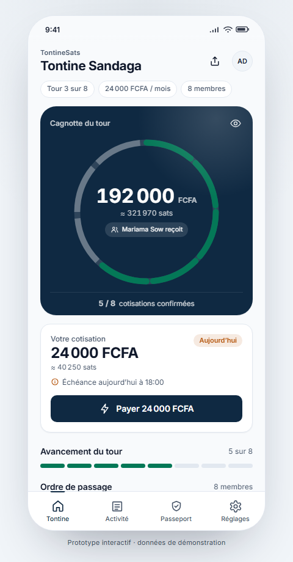
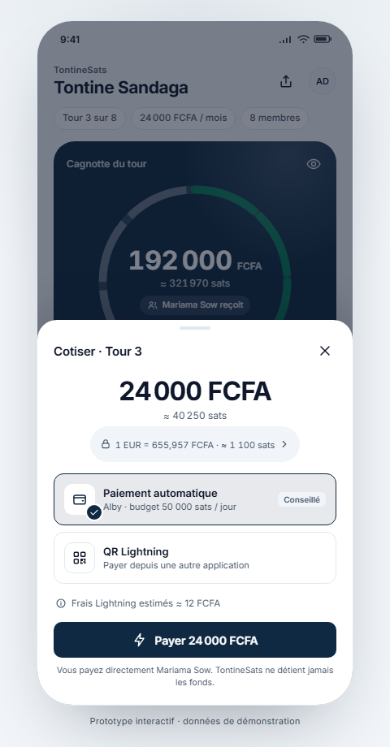
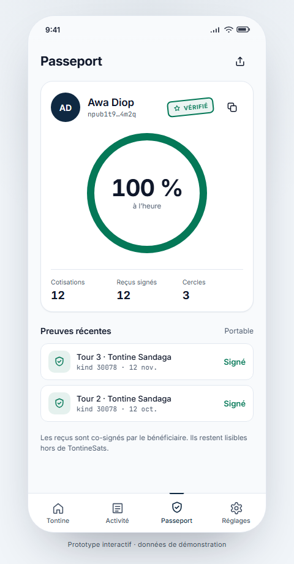
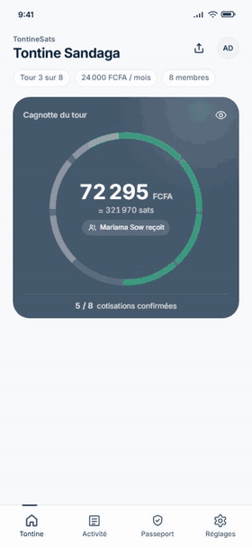
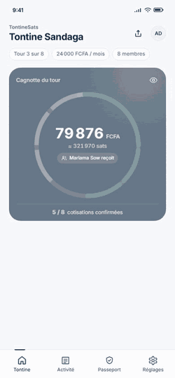

# TontineSats interactive prototype

A runnable design of the four core views from `docs/PRD.md`, built with the tokens from `docs/DESIGN_PRD.md` and the motion system from `docs/MOTION_REFERENCES.md`.

**Open it:** double-click `index.html`. No build, no package manager, no server required. Fonts come from Google Fonts and fall back to system fonts offline.



## What is built

| Screen | Route | What it shows |
| :--- | :--- | :--- |
| Circle dashboard | `#/dashboard` | Pot ring, one next action, segmented round progress, rotation list with `Ce tour` row, sticky pay CTA |
| Payment sheet | `#/pay` | Amount with sats subtitle, locked rate, NWC vs QR, fee estimate, three-stage settlement, success |
| Receipt | `#/receipt` | Four-step proof timeline, money breakdown, payer/beneficiary/hash references |
| Reputation passport | `#/passport` | On-time ring, verifiable counts, signed receipts, copyable `npub` |
| Activity | `#/activity` | Month calendar with day filtering, due contribution, signed receipts, empty day state |
| Join | `#/join` | Invite code, copy, WhatsApp share, join flow |
| Settings | `#/settings` | FR/EN/WO, light/dark/system, reduce motion, replay |
| Persona sheet | `#/persona` | Awa (Dakar), Moussa (Paris), Fatou (Thiès) |




## Web or native?

There is no native Android build. The product spec is a **React + Vite PWA** (`docs/PRD.md`): it installs from the browser to an Android home screen and runs in any modern browser. This prototype is plain HTML/CSS/JS for iteration speed; it runs on desktop and phone, and below 440px the phone frame becomes the full screen. No Play Store package, no native shell.

## Motion

Two recordings, made from the running prototype:





| Moment | Where | Timing |
| :--- | :--- | :--- |
| Ring draw + pot roll | dashboard load | 700ms draw, 70ms segment stagger, 700ms count-up |
| Sheet rise, drag, spring back | pay sheet | 280ms in, 200ms out, 60% / 500px·s⁻¹ dismiss |
| Method selection | pay sheet | 200ms stagger on open, 180ms spring check badge |
| Three-stage settlement | after `Payer` | 780ms per stage, then check draw |
| Success burst | paid state | check draw 320ms, confetti 900ms, once |
| Receipt timeline | receipt | 120ms per verified step |
| Passport gauge + stamp | passport, first view | 700ms ring, 500ms counters, spring stamp |
| Tab indicator, button press | everywhere | 200ms slide, 90ms scale 0.97 |

`prefers-reduced-motion` removes movement, and the in-app **Réduire les animations** switch does the same without waiting for the OS setting. Static and no-skeleton routes (`/static`, `/noboot`) exist for screenshots.

## Try these

- Scroll the dashboard: the sticky pay bar appears only after the action card leaves the view.
- Tap days in the calendar to filter; tap the same day again (or `Voir tout`) to clear.
- Tap a rotation row to open the member sheet: receipt for paid members, contribute for the current round, reminder copy for the rest.
- Pay with NWC: three stages, then confetti and the receipt.
- Pay with QR: a demo QR, a waiting pulse, and a 12s expiry error with retry.
- Use the avatar in the top right to switch to **Moussa**: amounts become euros, the rate chip stays FCFA-first.
- Switch to **Fatou**: the default method becomes QR.
- Join the tontine: the activity view becomes an empty state.
- Toggle dark mode, then switch language to English: amounts re-format to `24,000 FCFA`.
- Tap the eye: every amount masks, including the CTA label.

## Evidence

A scripted click-through (CDP, headless Edge) ran every control at **390×844** and **375×667**:

- 30/30 steps pass, **0 console exceptions**
- no horizontal overflow (`scrollWidth = viewport width` at 375)
- Escape closes the sheet; focus is trapped while it is open
- both themes, both languages, reduced-motion, empty state, QR error, replay
- calendar month navigation, day filtering, empty day, and the member sheet

Screens: `shots/` (22 stills). Recordings: `shots/motion-ring.gif`, `shots/motion-pay.gif`, `shots/motion-method.gif`.

## Honesty

This is a **prototype with demo data**, labelled as such in Settings. It does not connect to LNbits, NWC, or a Nostr relay; the payment sequence is simulated, the QR is a decorative pattern (labelled "QR de démonstration"), and the `npub`s are shortened placeholders. The personas and amounts come from the PRD. Clipboard may be blocked on `file://` in some browsers; serve the folder over HTTP if you need copy and Web Share at their best.

## Files

```
prototype/
  index.html        markup for all views and sheets
  styles.css        tokens, layout, components, motion
  app.js            state, i18n, routing, payment flow, confetti
  shots/            screenshots + two GIFs
```

`window.__tontineDemo` exposes `ring()`, `openPay()`, `finishPayment()` and `receipt()` for recording and testing only.

## Design notes

Direction comes from the locked visual constitution, not from a default: trust navy `#0F2942`, slate surfaces, Inter with tabular figures, JetBrains Mono for hashes and `npub`. The identity motif is the segmented round ring, repeated in the pot, the progress bar and the passport gauge. One semantic accent per state (emerald paid, amber due, crimson error). Motion is expressive only at the six moments listed above; everything else stays at 90–200ms.
